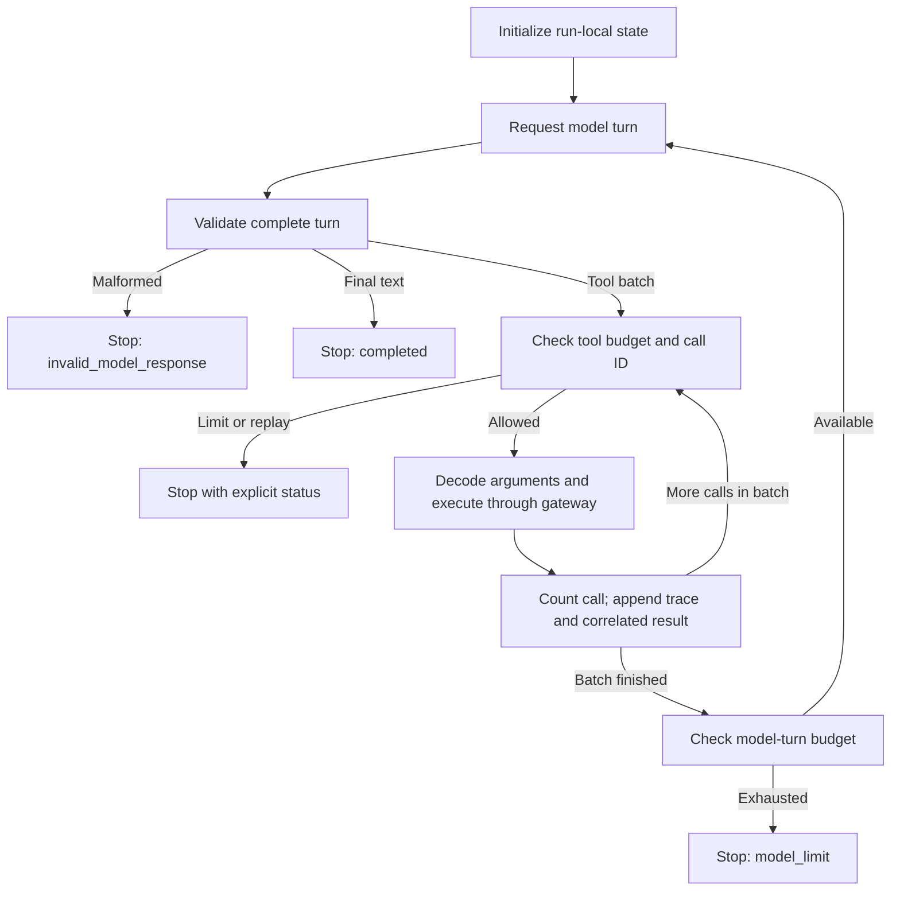

# Week 2 — Manual tool loop

The tool loop coordinates a model conversation with application-controlled
evidence reads. The model requests an operation; the application validates,
authorizes and executes it, then returns a correlated result. The loop owns
conversation state and termination. It does not decide access permissions.

This guide explains the [Phase 3 acceptance contract](WEEK-02-TOOL-LOOP-CONTRACT.md).
The [build plan](WEEK-02-BUILD-SHIP.md#phase-3) defines scope, and the
[tracker](WEEK-02-BUILD-SHIP-TRACKER.md#phase-3) records verified progress.
This document describes required behavior, not an additional completion claim.

## Components and responsibilities

| Component | Responsibility |
| --- | --- |
| [ToolLoop](../app/llm/tool_loop.py) | Model turns, call correlation, conversation, repetition tracking and limits |
| `LoopModel` protocol | Keyword callable receiving `messages` and `tools`; returns an untrusted response |
| [ToolGateway](../app/tools/gateway.py) | Argument validation, application authorization and gateway traces |
| [FixtureReader](../app/tools/fixture_reader.py) | Organization-scoped evidence lookup and typed output validation |
| [ToolError / ToolReadError](../app/tools/errors.py) | Safe error data / expected reader-failure exception |
| [ToolResult](../app/tools/contracts.py) | Exactly one non-null evidence value or error, plus gateway trace |

The loop calls `run(question=..., context=...)`. Its model dependency is invoked
as `model(messages=..., tools=...)`. Tool schemas come from
`TOOL_ARGUMENT_MODELS`, using each argument model's JSON schema.

Trusted organization identity enters through `TrustedContext`. It is never
accepted from model-generated tool arguments. Every fresh execution goes
through the gateway, including a repeated read with a new call ID.

## Model turn format

This is an application-owned normalized format, not the Responses API wire
format. SDK-specific translation is outside the Phase 3 batch.

A tool-request turn:

```json
{
  "tool_calls": [
    {
      "call_id": "c1",
      "name": "get_payment",
      "arguments_json": "{\"payment_id\":\"pay-shared\"}"
    }
  ],
  "final_text": null
}
```

A final-answer turn:

```json
{
  "tool_calls": [],
  "final_text": "The supplied evidence records a successful payment."
}
```

Require exactly one mode. `tool_calls` must be a list. A final turn requires
nonblank text; a tool turn requires a nonempty list and null final text. Calls
require nonblank string IDs/names and a string `arguments_json`. Duplicate call
IDs within the same batch invalidate the entire turn before execution.

Malformed argument JSON is different from a malformed turn. The call can still
be correlated, so pass an invalid argument value to the gateway and send its
`INVALID_ARGUMENTS` result back to the model.

## Lifecycle



Append the assistant tool-call turn to the conversation, followed by one tool
message for each processed call:

```text
role: tool
call_id: c1
content: ToolResult serialized as JSON text
```

The call ID associates a result with its request. Both successful evidence and
expected errors are returned this way. Process a multi-call batch serially.
After its results have been appended, request the next model turn.

## State and transitions

All state below resets at the beginning of every `run()`.

| State | Purpose | Update point |
| --- | --- | --- |
| `messages` | Conversation sent to the model | User question, assistant calls and tool results |
| `steps` | Number of processed calls, including rejected calls | After gateway processing |
| `model_turns` | Number of model invocations | After each returned model turn |
| `trace_list` | Inspectable record of processed calls | After each processed call |
| `seen_call_ids` | Detect invocation replay | Before processing a new call ID |
| `tools_used` | Detect repeated tool/argument combinations | After validating and normalizing arguments |

| Event | State change | Next action |
| --- | --- | --- |
| Model returns final text | Increment model-turn count | Return completed result |
| Model requests tools | Increment model-turn count; validate batch | Process calls within the budget |
| Tool returns evidence or expected error | Increment steps; append trace and correlated result | Continue batch, then request another turn |
| Previously processed call ID reappears | No additional execution | Stop with `repeated_call` |
| Execution or turn budget is exhausted | No additional bounded operation | Stop with the corresponding limit status |

`tools_used` is a set of `(tool_name, canonical_argument_json)` tuples, for
example `("get_payment", '{"payment_id":"pay-shared"}')`. Sorted JSON keys
make equivalent argument dictionaries share a fingerprint.

## Repetition and bounds

A reused call ID stops the run; it neither executes again nor replays cached
evidence. A new call ID with the same tool and normalized arguments requests a
fresh read: authorize and execute again, marking `fresh_read`. A first
combination is marked `first_read`. These labels describe request identity,
not whether source evidence changed or is current.

`max_tool_steps` and `max_model_turns` default to 8. Both require positive
integers, excluding booleans. Invalid arguments, unknown tools and denied
requests consume the call budget too.

Check the tool budget before each call, including within one model turn. A batch
may stop after its allowed prefix. After the last allowed call, a final model
answer is still permitted if the turn budget remains; further tool execution
is not. This phase does not resume partially processed batches.

## Results, errors and traces

`LoopResult` contains `status`, optional `final_text`, `steps`, `model_turns` and
`trace`. Only `completed` carries final text. Other statuses are `tool_limit`,
`model_limit`, `repeated_call` and `invalid_model_response`.

Each `LoopTrace` records the call ID, tool name, normalized valid arguments or
null, repetition classification, finite nonnegative duration in milliseconds,
and the complete gateway `ToolResult`.

Gateway outcomes remain distinct:

- `rejected`: invalid arguments, unknown tool or denied authorization.
- `failed`: expected reader failure caught as `ToolReadError`.
- `succeeded`: typed evidence returned successfully, including valid empty lists.

An error can be followed by a model final answer, so a completed loop does not
imply every tool succeeded. It also does not establish factual correctness.
Unexpected model or reader defects propagate rather than becoming fabricated
tool errors.

Keep raw invalid arguments and extra fields out of durable traces and tool
error messages. The conversation includes untrusted assistant turns; do not
log it wholesale. Treat evidence as data rather than instructions.

## Verification and boundary

From the project root, using the existing parent development environment:

```sh
../.venv/bin/python -m unittest discover -s tests -p test_tool_loop.py -v
../.venv/bin/python -m unittest discover -s tests -v
```

For a project-local environment, substitute `.venv/bin/python`. The
[acceptance tests](../tests/test_tool_loop.py) use a scripted model and synthetic
fixtures; they make no paid requests. They cover conversation/call correlation,
validation, authorization, safe traces, failure propagation, limits, replay,
fresh reads and isolation of run state.

Do not infer model tool-selection quality from a scripted test. SDK integration,
live evaluation, timeout recovery, backoff and idempotent fake-side-effect replay
require their own phase evidence. Phase 4 owns bounded recovery and replay.
